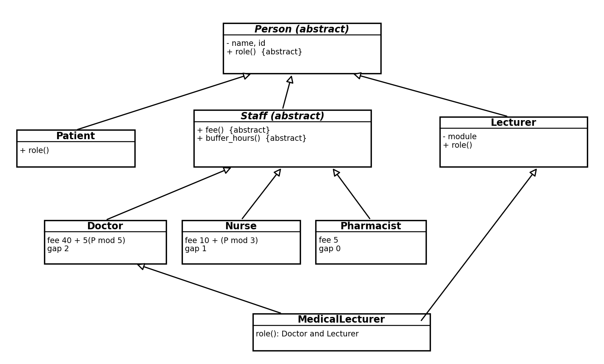
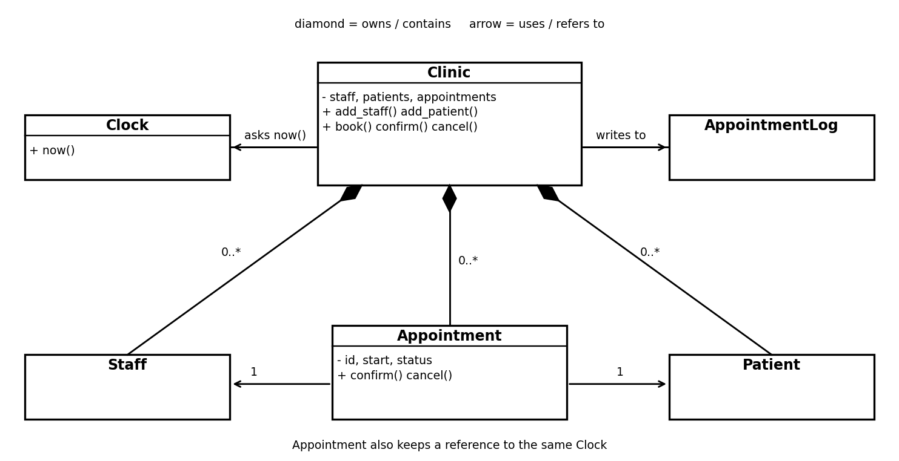
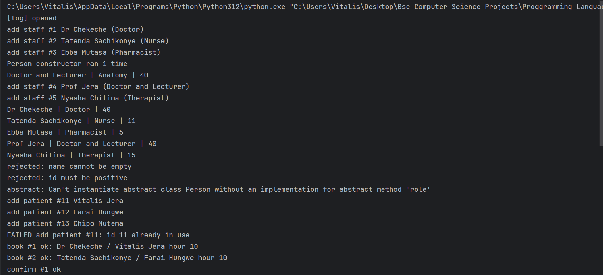
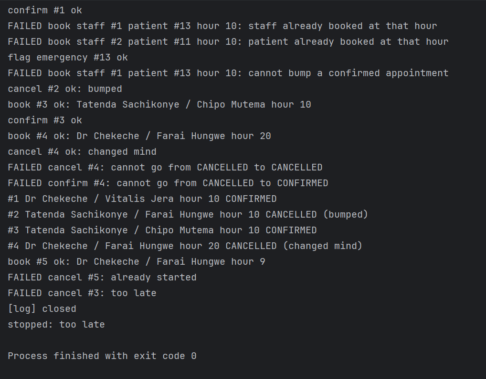

# Clinic Appointment System

Name: Tinevimbonashe Vitalis Jera
Reg No: R2420378
Module: Programming Languages

Name:  Mcgyver S.J Chibvongodze 
Reg No: R2420407
Module: Programming Languages

We used Python. Run it with `python main.py`. It writes to `appointments.log` in the same folder.

ourP is 26042005 which is Vitalis's birthday. P mod 5 = 0, P mod 3 = 1, P mod 4 = 1. So the doctor fee is 40, the nurse fee is 11, the pharmacist fee is 5 and our twist is number 1, Emergency.

Files: clock.py, people.py, appointment.py, clinic.py, main.py

## Question 1

##  Classes and diagram




```
Person (abstract)   name, id, role() {abstract}
  |-- Patient             emergency flag
  |-- Staff (abstract)    fee() {abstract}
  |     |-- Doctor
  |     |-- Nurse
  |     |-- Pharmacist
  |-- Lecturer            module

MedicalLecturer inherits Doctor and Lecturer

Clinic      has-a  Clock, AppointmentLog
Clinic      owns   Staff list, Patient list, Appointment list
Appointment refers to one Staff, one Patient and the Clock
```

## Question 2

All fields start with double underscore and are read through properties. There are no setters. Clinic never returns its own lists. staff(), patients() and summary() give back a tuple copy, and book() returns the appointment id and not the Appointment object, so nobody outside can call cancel() on it and skip the clinic.

Status only changes through confirm() and cancel(). The legal moves are

- PENDING to CONFIRMED
- PENDING to CANCELLED
- CONFIRMED to CANCELLED

Nothing leaves CANCELLED so a cancelled appointment cannot come back. cancel() also refuses when the start hour has been reached ("already started") and refuses a CONFIRMED one with less than 2 hours left ("too late").

Person raises ValueError when the name is empty or only spaces and when the id is 0 or negative. Appointment does the same for its own id and start hour. The invariants of Appointment and Clinic are in the comments above each class.

## Question 3

The loop in main.py is

```python
for s in clinic.staff():
    print(s.name, "|", s.role(), "|", s.fee())
```

Every Staff subclass has its own fee() and role() so Python picks the right one at run time. There is no isinstance or type tag anywhere. To prove a new subclass needs no edits We added Therapist in main.py (fee 15) and it goes through the same loop and into the same Clinic.

## Question 4

We used the `with` statement. Clinic has `__enter__` which opens the log and `__exit__` which closes it. `__exit__` runs when the block ends normally and when an error leaves it, so the log is closed once. The log also refuses to be opened a second time.

Failed actions are logged by a small context manager inside Clinic. It catches ClinicError, writes `FAILED <action>: <reason>` and raises the error again. The demo ends with an error leaving the with block on purpose and the output shows `FAILED cancel #3: too late` and then `[log] closed`.

!(diagram_relationships.png)

## Question 5

MedicalLecturer(Doctor, Lecturer). Every __init__ in the chain passes the rest of its arguments up with super().__init__(**rest) so Person.__init__ runs one time. main.py checks it with Person.made() before and after creating one, and it prints 1.

role() returns "Doctor and Lecturer". fee() returns the doctor fee, 40, because it is still a doctor in the clinic and Lecturer has no fee so nothing clashes.

In Java Lecturer has to become an interface because a class can only extend one class. MedicalLecturer would extend Doctor and implement Lecturer. The module field cannot live in an interface so it moves into MedicalLecturer and Lecturer only keeps `String module()`. Person is then only reached through Doctor so it is built once.

## Question 6

Booking checks the patient and the staff member at that hour. A non-cancelled appointment for either one at the same hour is refused. Ids are checked in one set inside Clinic and staff and patients share it. Every refusal is logged and raised.

Twist 1, Emergency. A patient can be flagged with flag_emergency(). If the staff member is busy at that hour with a PENDING appointment and the patient is an emergency, that appointment is cancelled with the reason "bumped" and the new one is booked. If the one in the way is CONFIRMED the booking fails. All the checks happen before the bump so a failed booking never bumps anyone.

## Question 7

D1. The 2 hour rule is in Appointment. Appointment is the only one who can change its own status so the rule cannot be skipped. If it was in Clinic then any other path that cancels would miss it. Staff does not know about statuses. A separate policy object would make the 2 hours easy to change but it adds a class for one number and Appointment would still have to call it. The cost of ourchoice is that changing the number means editing Appointment (NOTICE).

D2. The clock is an object that is passed in and it has now(), set() and advance(). A test just sets the hour it needs. If We called the system time directly We could not test "too late" or "already started" without waiting real time and the results would be different on every run.

D3. Nothing besides the new class. Clinic and the loop stayed the same.

D4. MedicalLecturer.fee() returns 40, the doctor fee. Person is created once because of cooperative super() with the MRO, each class calls the next one and Person is only in the line one time. Without it, if Doctor and Lecturer each called Person.__init__ directly then Person would run twice, there would be two names and two ids in one object and the counter would show 2.

D5. If writing to the log fails the clinic action has already happened so We do not undo it. The line is kept in memory and a warning goes to stderr. If closing fails it is the same, a warning, and it must not hide the error that was already on its way out of the with block.

D6. (1) A confirmed appointment cannot be bumped because both sides agreed to it and may have planned around it. Pending is only a request. The other three twist questions are for the other P mod 4 values so they do not apply to me.

## Question 8

main.py runs the demo in this order: staff and fees, MedicalLecturer, rejected constructors, booking, the two clash failures, duplicate id, emergency and bump, the confirmed one that cannot be bumped, cancelling and the cancelled one that cannot come back, started appointment, and the last deliberate failure `cancel #3` which is too late. The log is closed after that failure.


